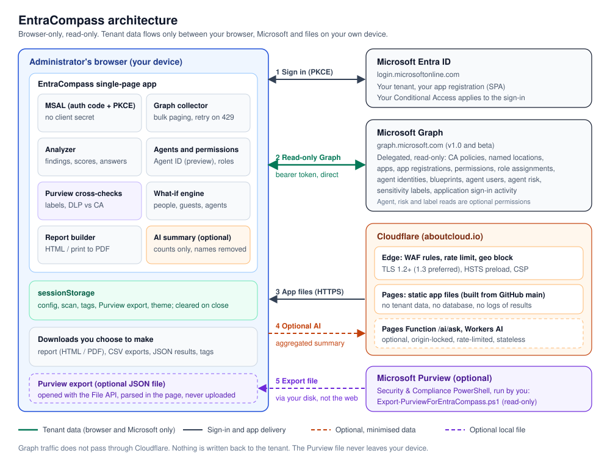
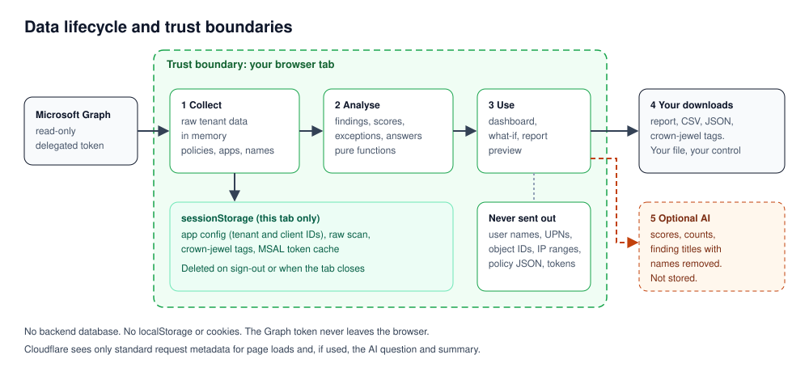

# EntraCompass

[](https://github.com/arusso-aboutcloud/EntraCompass/actions/workflows/ci.yml) [](https://github.com/arusso-aboutcloud/EntraCompass/actions/workflows/security-scan.yml) [](LICENSE)

**Conditional Access posture for the business.** A free, browser-only, read-only assessment of Microsoft Entra Conditional Access from a business, data protection (DLP) and security standpoint.

Live: **https://entracompass.aboutcloud.io** (try it with the built-in sample tenant, no sign-in needed).



## What it answers

EntraCompass turns your Conditional Access configuration into plain answers for management:

- Is everyone protected by MFA, on every application?
- How many exceptions do we have, and are they justified?
- Which business applications are outside protection, and what could break if we tighten?
- Are our crown-jewel applications protected to the right level?
- Do our trusted locations create a way around security?
- Are non-human identities (apps, services, automation) under control?
- Is company data protected on unmanaged and personal devices?
- Are administrators protected against phishing?
- What should we fix first?

## What it checks

| Area | Highlights |
|---|---|
| **Applications** | Every business app (SAML, App Proxy, password SSO, in-house, SaaS) mapped against every policy: always MFA, MFA with conditions, some users, or none. Phishing-resistant and device/session controls per app. Last-used date. |
| **Exceptions** | Every exclusion (apps, users, groups with member counts, roles, guests, locations, platforms, service principals) classified as *opens a gap*, *review*, *likely removable*, *deleted object* or *justified*. Emergency-access accounts detected. |
| **Crown jewels** | You tag the critical apps (with suggestions). They are checked against a higher bar: always MFA, phishing-resistant, device or session control, no exclusions. Tags export and import as JSON. |
| **Named locations** | Broad or private IP ranges in trusted locations, unknown countries, unused locations, MFA skipped on trusted networks. |
| **Workload identities** | App registrations with secrets or certificates: dormant credentials, secrets valid over a year, expiring credentials, multi-tenant apps with secrets, workload identity policies. |
| **Data protection (DLP)** | The identity side of a Purview DLP project: Defender for Cloud Apps session control, app-enforced restrictions, managed devices for Office 365, authentication contexts (used by sensitivity labels), insider risk (Adaptive Protection), guests, token protection, session lifetime. |
| **Modern baseline** | MFA for everyone, phishing-resistant admins, legacy auth, device code flow, risk policies, security info registration, Microsoft-managed policies, stale report-only policies. |
| **What-if** | Pick a user type, groups, roles, app, location, platform, device and client: see which policies apply and the outcome, today and if report-only policies were switched on. |
| **Executive report** | Self-contained HTML report: answers, scores, priority actions, 30/60/90-day roadmap, exceptions, crown jewels, DLP controls. Print to PDF or download. |
| **Ask AI (optional)** | Cloudflare Workers AI assistant. Only aggregated, non-identifying data is sent. |

### On SAML and on-prem apps

An application that signs in through Entra (SAML, OpenID Connect, App Proxy) is subject to Conditional Access, wherever it is hosted. Excluding it from a policy does not fix the underlying break; it removes control. EntraCompass flags these exclusions and recommends a dedicated policy the app can meet (for example a compliant or hybrid-joined device, or trusted network plus MFA).

## Privacy and security

- **Browser-only.** All analysis runs in your browser. There is no backend that stores tenant data.
- **Direct to Microsoft.** Graph calls go from your browser straight to `graph.microsoft.com`; they do not pass through Cloudflare.
- **Read-only.** Delegated Microsoft Graph permissions, read scopes only. It never changes your tenant.
- **Your own app registration.** PKCE single-page app flow, no client secret.
- **Session storage only.** Configuration, scan results and crown-jewel tags live in `sessionStorage` and are cleared when the tab closes. No `localStorage`, no cookies.
- **AI is optional** and receives only scores, counts and finding titles with names removed.
- **Hardened hosting.** TLS 1.2+ (1.3 preferred), HSTS preload, strict Content Security Policy, WAF and rate limiting at the Cloudflare edge.



## Documentation

- [Architecture](docs/architecture.md): components, scan pipeline, every Graph call, scoring, what-if engine, CI/CD.
- [Data security architecture](docs/data-architecture.md): data inventory, flows, trust boundaries, threats and mitigations, retention.
- [Security policy](SECURITY.md): reporting vulnerabilities, security model, edge security, customer controls.

## Set up

1. Create an app registration in your tenant:
   - **Single-page application** platform (not Web), redirect URI `https://entracompass.aboutcloud.io` (or your own host).
   - Microsoft Graph **delegated** permissions, then **Grant admin consent**:

     | Permission | Used for |
     |---|---|
     | `Policy.Read.All` | Conditional Access policies, named locations, authentication contexts and strengths |
     | `Application.Read.All` | Enterprise applications and app registrations |
     | `Directory.Read.All` | Resolving users, groups and roles named in policies; group member counts; user counts |
     | `AuditLog.Read.All` | Application sign-in activity (last used). Needs Entra ID P1 |
     | `User.Read` | Sign-in |

   Or run [`infra/New-EntraCompassApp.ps1`](infra/New-EntraCompassApp.ps1) `-GrantAdminConsent`.
2. Open the site, enter the tenant ID and client ID, sign in with a **Conditional Access Administrator**, **Security Reader** or **Global Reader** account.
3. Delete the app registration when the assessment is finished, if you like.

Large tenants are fully covered: every collection is paged and throttled requests are retried with Graph's `Retry-After`. There is no sampling.

## Limitations

- Purview DLP rules are not readable through Microsoft Graph from the browser; the DLP view covers the Conditional Access side.
- The what-if engine is simplified (device filters, authentication flows and insider risk are shown as "not evaluated"). Use Microsoft's What If tool to confirm a specific user.
- Application sign-in activity is a beta Graph report; when it is not available, usage-based checks are skipped and the report says so.

## Develop

```bash
npm ci
npm test        # analyzer and what-if unit tests
npm run dev     # http://localhost:5173 (sample data works without sign-in)
npm run build
```

Deployment: Cloudflare Pages (build `npm run build`, output `dist`, Pages Function `functions/ai/ask.js` with a Workers AI binding named `AI`).

## License

MIT. Built by [aboutcloud.io](https://www.aboutcloud.io).
